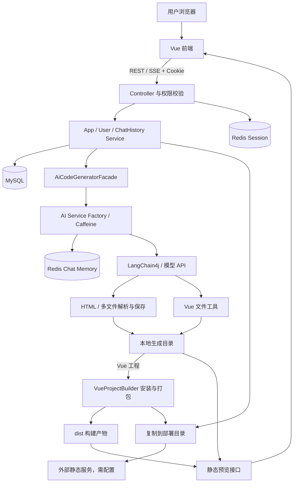
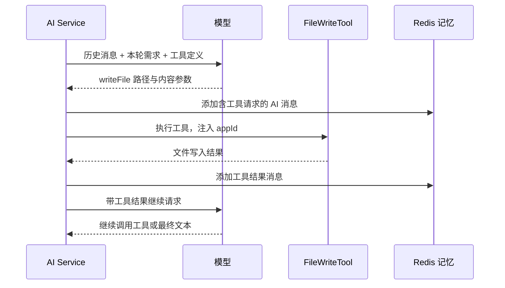
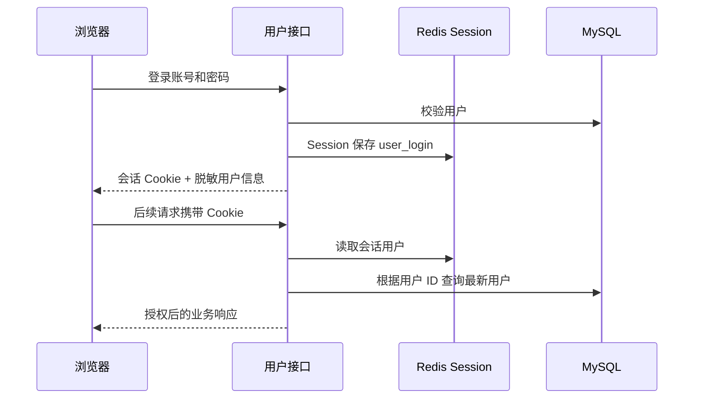

# 方案设计

更新日期：2026-10-22。本文按“是什么 → 为什么采用 → 实现思路 → 实现步骤”说明技术方案，重点展开 AI 路由与生成、独立 LangGraph 工作流、工具调用、流式响应、对话记忆、登录态、Vue 构建发布、源码下载和部署封面。

文中的“当前实现”均有仓库源码对应；“选型理由”是结合当前需求与代码给出的工程解释；“改进步骤”是后续建议，不能作为已经落地的功能。示例代码是核心逻辑摘录，完整实现以源码链接为准。

## 阅读导航

- [1. 技术选型与架构](#1-技术选型与架构)
- [2. 代码模块与扩展点](#2-代码模块与扩展点)
- [3. 数据模型与资源生命周期](#3-数据模型与资源生命周期)
- [4. 生成与上下文链路](#4-生成与上下文链路)
- [5. 两类产物保存方式](#5-两类产物保存方式)
- [6. 流式消息与前后端协议](#6-流式消息与前后端协议)
- [7. 关键接口与权限](#7-关键接口与权限)
- [8. 预览与部署边界](#8-预览与部署边界)
- [9. 本地运行与配置](#9-本地运行与配置)
- [10. AI 技术实现详解](#10-ai-技术实现详解)
- [11. 对话历史与记忆实现详解](#11-对话历史与记忆实现详解)
- [12. 用户登录态与权限实现详解](#12-用户登录态与权限实现详解)
- [13. 配套技术实现详解](#13-配套技术实现详解)
- [14. 技术难点](#14-技术难点)
- [15. 从零实现的推荐步骤与验证方法](#15-从零实现的推荐步骤与验证方法)
- [16. 拟改进方案](#16-拟改进方案)

## 1. 技术选型与架构

| 层次 | 当前技术 | 职责 |
| --- | --- | --- |
| 前端 | Vue 3、TypeScript、Vite 7、Ant Design Vue、Pinia、Vue Router | 用户界面、应用/对话管理、Markdown 展示、iframe 预览 |
| HTTP 接口 | Spring Boot 3.5.4、Java 21、Spring MVC、Reactor Flux | REST API、SSE 响应、权限与异常处理 |
| AI 编排 | LangChain4j 1.1.0 / 1.1.0-beta7、OpenAI 兼容接口 | 提示词、模型调用、记忆窗口、工具执行 |
| 独立工作流 | LangGraph4j 1.6.0-rc2、DashScope SDK 2.21.1 | 五节点生成链与图片工具；尚未接入聊天 SSE |
| 持久化 | MySQL、MyBatis-Flex 1.11.1、HikariCP | 用户、应用、业务对话历史 |
| 会话与记忆 | Spring Session Redis、RedisChatMemoryStore | 登录态共享、模型上下文存储 |
| 进程内缓存 | Caffeine | 应用级 AI Service 实例缓存 |
| 文件产物 | 本地文件系统 | 生成源码、复制部署文件 |
| 源码交付 | Hutool ZIP + Servlet 输出流 | 创建者下载经过过滤的生成目录 |
| 部署封面 | Selenium 4.33.0、WebDriverManager 6.1.0、腾讯云 COS SDK 5.6.227 | 无头 Chrome 截图、JPEG 压缩、对象存储上传 |
| 开发工具 | Maven Wrapper 3.9.11、Knife4j、OpenAPI 前端生成 | 构建与接口协作 |

版本来源：[pom.xml](../pom.xml)、[前端 package.json](../hui-ai-code-mother-frontend/package.json)、[Maven Wrapper 配置](../.mvn/wrapper/maven-wrapper.properties)。



## 2. 代码模块与扩展点

- `controller`：统一接口入口，普通请求返回 `BaseResponse`，生成请求返回 SSE。
- `service/impl`：应用创建与 AI 路由、权限和部署、源码下载、截图上传、用户身份、历史持久化与恢复。
- `ai`：AI Service 接口、按应用和生成类型创建服务的工厂、提示词与工具。
- `core`：生成门面；`parser` 按模式解析；`saver` 使用模板保存；`handler` 统一处理不同流；`builder` 执行 Vue 构建及同目录并发合并。
- `config`：跨域、Long JSON 字符串序列化、Redis 记忆、Vue 模型和 COS 客户端配置。
- `manager`、`utils`：COS 对象上传与封面 URL 组装、Chrome 截图和图片压缩。
- `src/main/java/dev/langchain4j`：与依赖同包同名的定制源码，扩展流式工具调用事件。
- 前端 `src/api`、`stores`、`pages`：生成的 API 类型/客户端、登录状态、业务页面。

新增生成模式需要同步枚举、AI 方法和提示词、工厂分支、生成门面、解析/保存或工具实现、流处理选择及前端展示，不能仅新增枚举值。

## 3. 数据模型与资源生命周期

| 表 | 关键字段 | 关系与索引 |
| --- | --- | --- |
| `user` | `id`、`userAccount`、`userPassword`、`userRole`、用户资料、时间、`isDelete` | 账号唯一；用户名称索引 |
| `app` | `id`、`appName`、`initPrompt`、`codeGenType`、`cover`、`userId`、`deployKey`、`deployedTime`、`priority` | 用户拥有多个应用；部署标识唯一；用户及名称索引 |
| `chat_history` | `id`、`appId`、`userId`、`message`、`messageType`、时间、`isDelete` | 消息属于应用；应用、时间及 `(appId, createTime)` 索引 |

表结构以 [初始化 SQL](../sql/create_table.sql) 为准。关系由业务代码维护，SQL 未声明外键。用户表使用 `if not exists`，应用和历史表没有该条件；初始化脚本不能当作可重复执行的迁移脚本。

MySQL 对话历史用于界面回放和业务持久化；Redis 保存模型当前记忆窗口；Caffeine 保存本进程服务对象。三者用途不同，Redis TTL 过期不会删除 MySQL 历史。

应用删除会尝试删除历史，但失败只记日志后继续删除应用；尚无事务保证与文件、记忆、缓存清理。后续建议引入明确的资源清理流程及失败重试。

## 4. 生成与上下文链路

1. `AppController.addApp` 获取登录用户并调用 `AppServiceImpl.createApp`；服务校验需求，调用 `AiCodeGenTypeRoutingService` 返回生成类型，再写入应用记录。路由同步调用普通 `ChatModel`，失败会中断创建，目前没有兜底类型。
2. `AppServiceImpl.chatToGenCode` 校验应用和创建者，写入本轮用户消息，读取应用生成类型。
3. 工厂以 `{appId}_{codeGenType}` 为 Caffeine 键，最多缓存 1000 个实例；写入 30 分钟或访问空闲 10 分钟后过期。
4. 每个实例建立以 `appId` 为 ID、最多 20 条消息的 `MessageWindowChatMemory`，存储于 Redis。记忆键只按应用区分，不按生成类型区分。
5. 新建服务时按时间倒序查询 MySQL 历史，使用 `limit(1, 20)` 跳过最新记录，再反转、清空记忆并恢复。这个偏移依赖“先写本轮用户消息”的调用顺序；其他入口及并发请求可能不满足假设。
6. HTML/多文件使用普通聊天模型及流式模型；Vue 使用独立流式模型和 `ToolManager` 注册的五种文件工具，通过 `@MemoryId` 将应用 ID 传给工具。
7. 门面返回 `Flux<String>`，流处理器负责呈现内容及 AI 历史写入，控制器再封装为 SSE。
8. Vue 模型流完成后，处理器在 `boundedElastic` 中调用 `VueProjectBuilder.buildProject`，等待成功后才保存 AI 回复并发送 `done`。

实现依据：[AI 工厂](../src/main/java/com/hui/huiaicodemother/ai/AiCodeGeneratorServiceFactory.java)、[历史服务](../src/main/java/com/hui/huiaicodemother/service/impl/ChatHistoryServiceImpl.java)、[生成门面](../src/main/java/com/hui/huiaicodemother/core/AiCodeGeneratorFacade.java)。

Vue 模型 Bean 名为 `reasoningStreamingChatModel`，但当前实际硬编码使用 `deepseek-chat`、8192 tokens；注释中的 `deepseek-reasoner` 是备选方案，未启用。其地址和密钥读取 `langchain4j.open-ai.chat-model` 配置。

### 4.1 独立 LangGraph 工作流

`CodeGenWorkflow` 作为 Spring Service 提供 `executeWorkflow(prompt, appId)`，依次执行 `ImageCollectorNode → PromptEnhancerNode → RouterNode → CodeGeneratorNode → ProjectBuilderNode`。图片收集结果用于增强提示词；类型路由失败回退 HTML；代码生成复用现有门面；Vue 构建成功并检查 `dist/index.html` 后才返回构建目录。

显式 `appId` 用于隔离输出目录和模型记忆。无 ID 的独立调用分配唯一 ID，但不会创建数据库应用记录。图片服务失败可降级，生成或构建失败向调用方传播。该入口没有接入现有聊天 SSE，也不自动完成应用入库、业务历史持久化或部署。

Pexels 搜图需要 `PEXELS_API_KEY`，DashScope Logo 生成需要 `DASHSCOPE_API_KEY`；模型可用 `DASHSCOPE_IMAGE_MODEL` 覆盖，默认 `wan2.2-t2i-flash`。Mermaid 架构图还需要 PATH 中可执行的 CLI 和可用 COS 上传配置。缺少图片 Key 返回空列表；图编排测试使用 Mock／本地 HTTP，不代表供应商线上接口可用。完整配置、源码与验证范围见 [LangGraph 同步与验证](langgraph-sync-verification.md)。

## 5. 两类产物保存方式

| 模式 | 生成协议 | 保存时机与目录 |
| --- | --- | --- |
| `html` | 文本流，结束后解析 HTML | `tmp/code_output/html_{appId}/index.html` |
| `multi_file` | 文本流，结束后解析 HTML/CSS/JS | `tmp/code_output/multi_file_{appId}/`，保存 `index.html`、`style.css`、`script.js` |
| `vue_project` | TokenStream，模型调用写文件工具 | 工具执行时写入 `tmp/code_output/vue_project_{appId}/` 下的相对路径 |

HTML/多文件保存失败会抛出业务异常；Vue 工具把 I/O 失败返回为工具文本，流处理器展示真实执行结果。Vue `done` 等待构建成功；工具级失败是否已被模型修正仍需后续任务状态校验。

五种文件工具共用 `ProjectPathResolver`：只接受当前应用源码内的相对路径，拒绝绝对路径、目录穿越、链接及依赖/产物/环境目录。`FileModifyTool` 要求非空且唯一匹配的旧内容，避免误改相似元素。

## 6. 流式消息与前后端协议

Vue 模式内部消息包含三种类型：

| 类型 | 来源 | 流处理器输出 |
| --- | --- | --- |
| `ai_response` | 模型文本片段 | 原样追加文本 |
| `tool_request` | 部分工具调用事件 | 同一工具 ID 首次按 `ToolManager` 输出对应工具名称 |
| `tool_executed` | 工具执行完成 | 文件路径及参数中的内容，以 Markdown 代码块展示并保存历史 |

内部 JSON 经 [JsonMessageStreamHandler](../src/main/java/com/hui/huiaicodemother/core/handler/JsonMessageStreamHandler.java) 转成可读文本后，控制器输出统一外部协议：

```text
data: {"d":"本次文本片段或工具执行说明"}

event: done
data:

```

前端使用 `EventSource`，携带 Cookie，从 `JSON.parse(event.data).d` 累积回复；收到 `done` 关闭连接，再刷新预览。内部工具 JSON 没有直接暴露为前端事件类型。初始化或流式阶段失败时发送命名事件 `generation_error`，数据为 `{code, message}`；错误分支不发送 `done`，前端结束加载并展示受控提示。

定制 LangChain4j 源码贯通部分工具请求回调、模型响应处理及 `TokenStream`。升级依赖时需检查同包同名类的签名兼容、回调顺序和工具事件完整性；当前并无独立回归测试覆盖这些改动。

当前前端把部分 `EventSource.CONNECTING` 错误视为完成，组件卸载也未明确关闭局部变量中的连接。拟将生成状态分为运行、成功、失败、取消，并使断连结果可核验。

## 7. 关键接口与权限

以下路径均以 `/api` 为前缀，完整定义以源码和 Knife4j 为准。

| 方法与路径 | 用途 | 权限 |
| --- | --- | --- |
| `POST /user/register`、`POST /user/login` | 注册、登录 | 公开 |
| `GET /user/get/login`、`POST /user/logout` | 登录信息、退出 | 按登录态处理 |
| `POST /app/add` | 创建应用 | 登录用户 |
| `GET /app/get/vo` | 应用详情 | 当前公开 |
| `POST /app/my/list/page/vo` | 我的应用 | 登录用户 |
| `POST /app/good/list/page/vo` | 精选应用 | 公开 |
| `POST /app/update`、`POST /app/deploy` | 改名、部署 | 创建者 |
| `GET /app/download/{appId}` | 下载源码 ZIP | 仅创建者，管理员不例外 |
| `POST /app/delete` | 删除应用 | 创建者或管理员 |
| `GET /app/chat/gen/code?appId=...&message=...` | SSE 生成 | 创建者 |
| `GET /chatHistory/app/{appId}` | 游标查询历史 | 创建者或管理员 |
| `POST /chatHistory/admin/list/page/vo` | 管理员历史查询 | 管理员 |
| `GET /static/{目录标识}/**` | 生成文件预览 | 当前未做应用权限校验 |

Long 统一序列化为字符串，避免浏览器整数精度丢失；前端 OpenAPI 类型需要与此保持一致。

## 8. 预览与部署边界

预览由 [StaticResourceController](../src/main/java/com/hui/huiaicodemother/controller/StaticResourceController.java) 读取生成根目录，目录入口重定向到带斜杠地址，默认返回 `index.html`。当前实现无严格路径规范化和根目录限制。

HTML/多文件部署复制 `{codeGenType}_{appId}` 源目录；Vue 部署先构建，再复制 `dist` 内容至 `tmp/code_deploy/{deployKey}`。更新数据库后返回 `http://localhost/{deployKey}/`。这个地址需要额外静态服务映射部署根目录；后端预览接口读取的是生成目录，不负责托管部署目录。

Vue 工程生成结束后，后端虚拟线程自动执行 `npm install`（300 秒超时）和 `npm run build`（180 秒超时），检查 `dist/index.html`。前端为 `vue_project` 构造 `.../dist/index.html` 预览地址；首次构建完成前可能需等待并刷新，尚无构建状态事件。

自动构建与部署构建共用 `VueProjectBuilder`：规范项目路径后，以路径 URI 为键保存正在进行的 `CompletableFuture<Boolean>`，同进程同目录重叠请求等待并复用结果，结束后移除以允许后续重建。不同目录可并行；这不提供跨进程协调，也不阻止生成工具同时改写源码。

命令 stdout/stderr 合并重定向到项目内 `npm-install.log`、`npm-build.log`，避免输出管道未消费导致阻塞；失败或超时记录最后至多 16 KiB 输出，超时/中断时清理仍在运行的进程树。Windows 使用命令解释器运行 `npm.cmd`。

当前安装和构建仍在后端宿主环境运行。后续需迁入隔离构建环境，以版本目录和原子切换保护已有站点。故障证据、恢复步骤及测试见 [Vue 构建与故障排查](vue-build-troubleshooting.md)。

### 8.1 源码 ZIP 下载

`AppController.downloadAppCode` 校验应用存在和创建者身份，定位 `tmp/code_output/{codeGenType}_{appId}`，交给 `ProjectDownloadServiceImpl` 直接写入 Servlet 输出流，响应为 `application/zip`，附件名为 `{appId}.zip`。Vue 下载的是源码目录，部署使用的 `dist` 不包含在压缩包中。

过滤器检查相对路径的每个部分，跳过 `node_modules`、`.git`、`dist`、`build`、`.DS_Store`、`.env`、`target`、`.mvn`、`.idea`、`.vscode`，以及 `.log`、`.tmp`、`.cache` 后缀。当前规则只精确排除 `.env`，不覆盖 `.env.local` 等变体，也未专门处理符号链接；不能把此过滤器视为完整敏感文件审计。

前端下载按钮仅向创建者开放，通过携带 Cookie 的 `fetch` 取得 Blob，再创建临时下载链接。后端权限仍是最终依据；压缩包内容、错误响应与跨域附件名读取尚待端到端验证。

源码：[下载控制器](../src/main/java/com/hui/huiaicodemother/controller/AppController.java)、[ProjectDownloadServiceImpl](../src/main/java/com/hui/huiaicodemother/service/impl/ProjectDownloadServiceImpl.java)。

### 8.2 部署封面截图与 COS 上传

部署目录复制和数据库更新成功后，`AppServiceImpl.generateAppScreenshotAsync` 使用虚拟线程异步访问部署 URL。`WebScreenshotUtils` 通过无头 Chrome 打开页面，等待 `document.readyState` 及额外 2 秒，保存 PNG 后按 0.3 质量压缩为 JPEG。截图服务将文件上传到 COS 的 `/screenshots/yyyy/MM/dd/` 前缀，成功后更新应用 `cover`，上传阶段结束时清理本次本地截图目录。

`CosClientConfig` 读取本机配置创建 `COSClient`，`CosManager` 把 `host` 与对象键拼成访问 URL。前端 `normalizeCoverUrl` 兼容没有协议、`//host/path`、完整 HTTP/HTTPS 地址；应用卡片在加载失败时显示占位图。

当前浏览器驱动为静态共享实例，没有并发隔离；`WebScreenshotUtils` 不是 Spring Bean，其 `@PreDestroy` 不能据此保证执行。异步任务尚无状态、失败重试和统一异常处理，因此部署接口成功不表示封面已经生成。Chrome、驱动、部署站点可达性和 COS 权限均需单独验收。

源码：[截图工具](../src/main/java/com/hui/huiaicodemother/utils/WebScreenshotUtils.java)、[ScreenshotServiceImpl](../src/main/java/com/hui/huiaicodemother/service/impl/ScreenshotServiceImpl.java)、[CosManager](../src/main/java/com/hui/huiaicodemother/manager/CosManager.java)、[封面 URL 处理](../hui-ai-code-mother-frontend/src/utils/cover.ts)。

## 9. 本地运行与配置

1. 安装 Java 21、Node.js（建议 22.12+ 或符合 Vite 7 要求的更新版本）、MySQL 和 Redis。
2. 在空数据库环境执行 `sql/create_table.sql`。已有数据库应采用增量迁移，避免直接重复建表。
3. 新建 `src/main/resources/application-local.yml`，覆盖本机数据库、Redis 和模型配置。当前默认启用 `local` profile，且该文件被 Git 忽略。
4. Redis 默认 `localhost:6379`，模型记忆 TTL 为 3600 秒；Session 和 Cookie 配置为 30 天。
5. 模型地址和密钥同时配置 `langchain4j.open-ai.chat-model` 与 `streaming-chat-model`。Vue 模型读取前者的地址/密钥；仅配置后者不足以启用 Vue 生成。
6. 仓库根目录运行 `./mvnw spring-boot:run`；Windows 使用 `.\mvnw.cmd spring-boot:run`。后端端口 8123，接口文档为 `http://localhost:8123/api/doc.html`。
7. 前端目录运行 `npm ci`、`npm run dev`。`VITE_API_BASE_URL` 默认 `http://localhost:8123/api`，`VITE_DEPLOY_DOMAIN` 默认 `http://localhost`；部署服务地址须与后端 `AppConstant.CODE_DEPLOY_HOST` 一致。
8. 生成目录相对于后端启动时的工作目录，部署环境需配置持久化存储和静态服务。后端进程的 PATH 需包含 Node.js/npm；更新构建器后需重启后端。
9. 在 `application-local.yml` 配置 `cos.client.host`、`secretId`、`secretKey`、`region`、`bucket`；`host` 包含 `https://`。COS 客户端当前启动即创建，本机测试也需要有效的配置字段，创建 Bean 不等于已经验证上传成功。
10. 部署截图需要本机 Chrome、匹配的 ChromeDriver，以及从后端到部署站点和 COS 的网络访问。WebDriverManager 会管理驱动获取；封面任务运行于部署返回后的虚拟线程中。
11. 使用独立 LangGraph 图片工作流前，配置 `PEXELS_API_KEY` 和 `DASHSCOPE_API_KEY`；它们对应用启动可选，但对对应真实图片功能必需。架构图还需要 Mermaid CLI 和 COS。配置示例、无 Key 时的行为与未联调项目见 [LangGraph 配置说明](langgraph-sync-verification.md)。

普通 `chat-model` 指定 `custom-headers.Accept-Encoding: gzip`，规避当前间接依赖 `org.brotli:dec:0.1.2` 的同步响应截断。不要把 HTTP 200 视为响应正文完整的证明；根因、对照实验与测试命令见 [AI 路由故障排查](ai-routing-troubleshooting.md)。

生产配置还需收敛允许携带 Cookie 的跨域来源、采用更适合密码存储的哈希算法、控制模型请求/响应日志。当前代码允许所有来源模式、使用固定盐 MD5，并启用模型日志，不能直接视为生产安全配置。

## 10. AI 技术实现详解

### 10.1 LangChain4j AI Service 与模型接入

**是什么。** LangChain4j 把 Java 方法、系统提示词、模型连接、对话记忆和工具执行组合为 AI Service。项目通过 `AiServices.builder(AiCodeGeneratorService.class)` 创建接口代理，由代理组织模型请求和返回值。模型使用 OpenAI 兼容接口访问 DeepSeek，Java 侧通过 `ChatModel` 与 `StreamingChatModel` 区分完整返回和流式返回。

**为什么采用。** 生成一次代码需要同时处理提示词、历史消息、工具定义和模型响应。把这些工作交给 AI Service 后，业务层只需传入应用 ID、生成类型和本轮需求；也能为不同生成类型组合不同模型与工具，而不在控制器里手工拼接模型 HTTP 请求。

**实现思路。** 普通生成和 Vue 工程生成共用一个服务接口，由工厂为每个应用创建对应实例；接口定义业务能力，模型 Bean 定义连接参数，工厂决定运行时组合。

**实现步骤（当前）。**

1. 在 `pom.xml` 引入 LangChain4j 核心、OpenAI Spring Boot Starter、Reactor 适配和 Redis 记忆依赖；当前核心版本为 1.1.0，部分集成为 1.1.0-beta7。
2. 在 `application.yml` 配置模型 `base-url`、`api-key`、`model-name`、`max-tokens` 等，本机密钥由忽略提交的 local 配置覆盖。
3. 在 `AiCodeGeneratorService` 声明 HTML、多文件的同步/流式方法，以及 Vue 工程的 `TokenStream` 方法。
4. 在工厂注入普通 `ChatModel`、`openAiStreamingChatModel` 和 Vue 使用的 `reasoningStreamingChatModel`。
5. 对 HTML/多文件绑定普通模型、流式模型和应用记忆；对 Vue 绑定独立流式模型、记忆提供器和 `FileWriteTool`。
6. 在门面中获取工厂实例并调用对应方法，再交给解析、保存和流处理链路。

**配置边界。** 普通同步模型配置了 JSON 响应格式、严格 JSON Schema 和重试参数；普通流式模型使用另一组配置。Vue 模型由 Java 手工构建，当前硬编码 `deepseek-chat` 和 8192 tokens，只读取 `chat-model` 下的地址、密钥，不会自动继承该配置中的所有其他参数。Bean 名称中的 reasoning 不代表已启用推理模型，也不代表输出了模型内部推理过程。

源码：[AI Service](../src/main/java/com/hui/huiaicodemother/ai/AiCodeGeneratorService.java)、[工厂](../src/main/java/com/hui/huiaicodemother/ai/AiCodeGeneratorServiceFactory.java)、[Vue 模型配置](../src/main/java/com/hui/huiaicodemother/config/ReasoningStreamingChatModelConfig.java)。

### 10.2 提示词工程：把自然语言需求约束为可处理的输出

**是什么。** 系统提示词定义 AI 的职责、技术栈、文件结构、输出格式和约束；用户消息提供本轮业务需求。项目使用 `@SystemMessage(fromResource = "prompt/...")` 从资源文件加载提示词。

**为什么采用。** 用户只说“做一个任务网站”，无法保证模型输出的文件组织和协议符合后端处理方式。按生成类型拆分提示词，可以让 HTML 解析器、三文件保存器和 Vue 文件工具各自得到期望形式的结果，也便于独立迭代。

**实现步骤（当前）。**

1. HTML 提示词要求使用原生 HTML/CSS/JS，将样式和脚本内联，输出 HTML 代码块。
2. 多文件提示词要求输出 `index.html`、`style.css`、`script.js`，约定各代码块的语言标记以及文件之间的引用。
3. Vue 提示词指定 Vue 3、Vite、Vue Router 和项目目录，要求通过文件写入工具逐个创建文件，先给简要计划，最后给完成提示。
4. Vue 提示词要求 `base: './'` 支持子路径资源，使用 hash 路由，约束文件总数小于 30、输出总 token 数小于 20000。
5. 将三个提示词分别绑定到服务方法；前端把用户的初始需求或修改意见作为本轮消息发送。
6. 后端按模式解析代码或执行工具，把结果落到应用目录。

**边界。** 提示词约束需要服务端校验支持。当前“文件数小于 30”和用户指定的代码行数没有硬校验；可构建性由后续 npm 命令及入口检查判断，但构建结果已接入 SSE 完成条件，完整任务状态仍待完善。Vue 模型 8192 的配置也不能理解为整个多轮工具链有 20000 token 的总预算。Vue 提示词中的 Node.js 18+、Vite 4 示例是生成项目的约定，平台前端自身使用 Vite 7，两者运行环境需要分别判断。

源码：[HTML 提示词](../src/main/resources/prompt/codegen-html-system-prompt.txt)、[多文件提示词](../src/main/resources/prompt/codegen-multi-file-system-prompt.txt)、[Vue 提示词](../src/main/resources/prompt/codegen-vue-project-system-prompt.txt)。

### 10.3 生成类型路由与门面模式

**是什么。** `AiCodeGenTypeRoutingService` 根据需求返回 `CodeGenTypeEnum`，决定应用创建时保存的生成类型；后续 `AiCodeGeneratorFacade` 提供统一生成入口，根据该类型协调 AI Service、解析器与保存器。

**为什么采用。** HTML、三文件网页和 Vue 工程的产物结构与保存方式不同。统一入口可以让应用服务专注于“谁能生成、给哪个应用生成、如何记录历史”，具体生成差异放到门面及策略实现中。

**实现步骤（当前）。**

1. `AiCodeGenTypeRoutingServiceFactory` 使用普通 `ChatModel` 创建无对话记忆的路由代理，通过 `@SystemMessage(fromResource = "prompt/codegen-routing-system-prompt.txt")` 加载路由规则。
2. 创建应用时同步分类：简单展示单页选 `HTML`，简单静态多页选 `MULTI_FILE`，涉及复杂交互、数据管理等选 `VUE_PROJECT`；接口直接返回枚举，业务层保存其 `getValue()`。
3. 对话请求读取应用记录，将类型字符串转为枚举，不支持的值直接拒绝。
4. 工厂按应用 ID 和类型返回对应 AI Service。
5. 门面对 HTML/多文件调用 `Flux<String>` 方法，对 Vue 调用带 `@MemoryId` 的 `TokenStream` 方法。
6. 文本模式走解析保存执行器，Vue 模式走工具及回调适配。
7. 结果统一为 `Flux<String>` 交给业务层；同步 `generateAndSaveCode` 入口只支持 HTML 和多文件。

**扩展方式。** 新增类型时依次补枚举、路由规则、生成提示词、AI 方法、工厂分支、门面分支、产物处理器、流处理器和前端类型映射。当前分类仅在创建时执行，后续对话沿用已保存类型；分类评估、失败兜底及创建超时体验仍需完善。

源码：[生成类型枚举](../src/main/java/com/hui/huiaicodemother/model/enums/CodeGenTypeEnum.java)、[路由接口](../src/main/java/com/hui/huiaicodemother/ai/AiCodeGenTypeRoutingService.java)、[路由提示词](../src/main/resources/prompt/codegen-routing-system-prompt.txt)、[生成门面](../src/main/java/com/hui/huiaicodemother/core/AiCodeGeneratorFacade.java)。

### 10.4 结构化返回、代码块解析与模板保存

**是什么。** 同步方法用 Java 对象表达生成结果；流式文本先连续显示，结束后再从 Markdown 代码块中提取代码。解析策略负责“提取什么”，保存模板负责“如何校验并写到哪里”。

**为什么采用。** 同步场景可以一次获得完整对象；流式场景中 JSON 或代码块可能还没有闭合，逐块解析容易失败。先传输片段、结束后解析完整文本，可以兼顾即时展示和最终落盘；保存模板则统一目录与输入校验。

**实现步骤（当前）。**

1. `HtmlCodeResult` 声明 `htmlCode`、`description`；`MultiFileCodeResult` 声明 HTML、CSS、JS 和描述，并通过 `@Description` 提供字段含义。
2. 同步方法返回上述对象，直接交给保存执行器；流式方法返回文本片段，由 `processCodeStream` 的 `StringBuilder` 累积。
3. 流完成后调用 `CodeParserExecutor`，按类型选择解析策略。
4. HTML 解析器取第一个 html 代码块，未匹配时把完整响应当作 HTML；多文件解析器分别提取 html、css、js/javascript 代码块。
5. `CodeFileSaverExecutor` 选择保存模板；模板执行“校验对象 → 创建应用目录 → 保存文件 → 返回目录”。HTML 为必填，CSS/JS 非空时才写入。
6. 输出目录固定按类型和应用 ID 组织，同一应用再次生成会覆盖同名文件。

**边界。** 当前正则只提取每种语言的第一个代码块，HTML 兜底也可能把说明文字写成页面。同步 JSON 格式参数与流式 Markdown 代码块是两种不同的处理约定，需分别验证。文件覆盖不具备版本回滚；空 CSS/JS 跳过写入时，旧文件也不会自动删除。

源码：[结果对象](../src/main/java/com/hui/huiaicodemother/ai/model/MultiFileCodeResult.java)、[解析执行器](../src/main/java/com/hui/huiaicodemother/core/parser/CodeParserExecutor.java)、[保存模板](../src/main/java/com/hui/huiaicodemother/core/saver/CodeFileSaverTemplate.java)。

### 10.5 Function Calling：让模型通过工具创建 Vue 文件

**是什么。** Function Calling 允许模型返回工具名称和结构化参数，再由服务端执行受控 Java 方法。工具由 `BaseTool` 统一协议、`ToolManager` 注册，模型可按目录读取 → 文件读取 → 局部替换的顺序修改 Vue 项目，Java 进程执行实际文件操作。

**为什么采用。** Vue 工程包含多个目录和不同文件名，按 html/css/js 三个代码块提取无法表达完整项目。文件工具可以保留路径、内容和执行结果，支持模型逐步组织工程，也让执行过程可展示。

**实现步骤（当前）。**

1. 使用 `@Tool("写入文件到指定路径")` 暴露方法，使用 `@P` 描述路径和内容参数。
2. Vue AI Service 构建时调用 `.tools((Object[]) toolManager.getAllTools())` 注册工具。
3. `generateVueProjectCodeStream(@MemoryId long appId, @UserMessage String userMessage)` 将应用 ID 传入调用上下文。
4. 工具通过 `@ToolMemoryId Long appId` 接收该上下文值，使应用 ID 来自服务端调用；控制器在此之前已检查应用创建者权限。
5. 模型返回 `writeFile` 请求及参数；AI Service 根据工具名称找到执行器，调用 Java 工具。
6. 相对路径解析到 `tmp/code_output/vue_project_{appId}/`，创建父目录，以创建或截断方式写文件，返回成功或 I/O 失败文本。
7. 工具结果作为 `ToolExecutionResultMessage` 加入记忆并再次发送给模型；模型可以继续请求下一个文件，直到返回不含工具请求的最终回复。
8. 工具执行回调交给流处理器展示路径和代码，最终回复完成后结束本轮生成。



**边界。** 工具调用是能力授予边界，提示词不能代替文件路径校验。当前注册目录读取、文件读取、唯一替换、文件写入和文件删除工具；安装依赖与构建仍由服务端控制。工厂配置了未知工具名策略，但本地定制的流式处理器直接按名称查执行器，仍需验证未知工具请求能否正确走兜底，不能只凭配置就认为该分支已可靠覆盖。

源码：[文件工具](../src/main/java/com/hui/huiaicodemother/ai/tools/FileWriteTool.java)、[工具循环处理](../src/main/java/dev/langchain4j/service/AiServiceStreamingResponseHandler.java)。

### 10.6 LangChain4j 源码定制：透传部分工具调用事件

**是什么。** 在模型流中，正文与工具参数属于不同事件；工具参数也可能分多个片段返回。项目在依赖的同包同名类中扩展回调，让业务层能在工具执行前知道模型正在选择工具。

**为什么采用。** 如果只展示普通文本，模型生成大段文件参数时页面可能长时间没有可见更新。透传部分工具请求，再结合执行完成回调，可以展示“选择工具 → 文件内容与执行过程”。定制解决的是事件可见性，不能据此保证生成结果正确。

**实现步骤（当前）。**

1. 在 `TokenStream` 与 `StreamingChatResponseHandler` 增加部分/完整工具请求回调签名。
2. `OpenAiStreamingChatModel` 读取响应中的 `delta.content` 和 `delta.toolCalls`；正文直接交给文本回调。
3. `ToolExecutionRequestBuilder` 维护工具 index、ID、名称和累积参数，支持片段中省略 ID/名称时沿用先前值。
4. 每收到非空参数片段，构造部分 `ToolExecutionRequest` 并触发回调；其 `arguments` 是本次参数片段，通常不能独立解析成 JSON。
5. 工具索引切换或模型流结束时构造完整请求回调；`OpenAiStreamingResponseBuilder` 同时负责聚合最终模型响应。
6. `StreamingChatModel` 的包装处理器继续转发工具事件，`AiServiceTokenStream` 保存应用注册的回调并传给服务响应处理器。
7. `AiServiceStreamingResponseHandler` 转发部分请求；完整模型响应到达后执行其中的工具，并触发 `onToolExecuted`，需要继续模型调用时沿用回调。
8. 门面订阅部分请求和工具执行结果，用内部消息对象传给 Reactor 流。

**边界。** 当前业务门面使用部分请求、执行完成及最终回复回调，没有使用完整工具请求回调；定制服务处理器也未显式覆写完整工具请求的转发。完整参数实际执行取自聚合后的 AI 消息。部分回调没有空值保护，多工具交错、缺少 index/ID、空参数、未注册回调等情况都需要专门回归，不能把“加了回调签名”理解为所有链路已经支持。

源码：[TokenStream](../src/main/java/dev/langchain4j/service/TokenStream.java)、[模型流处理](../src/main/java/dev/langchain4j/model/openai/OpenAiStreamingChatModel.java)、[参数聚合器](../src/main/java/dev/langchain4j/internal/ToolExecutionRequestBuilder.java)、[服务流适配](../src/main/java/dev/langchain4j/service/AiServiceTokenStream.java)。

### 10.7 Reactor Flux：把回调式生成接入统一消息流

**是什么。** `Flux<String>` 表达随时间到达的多个字符串和完成/错误信号；`TokenStream` 则通过注册回调接收模型与工具事件。项目使用适配器把两者统一，让 Spring MVC 控制器返回 SSE。

**为什么采用。** HTML/多文件已经返回 Flux，Vue 工具生成返回 TokenStream。把适配放在门面后，应用服务和控制器可以复用一套历史记录和外部传输逻辑；项目使用 Flux 并不表示整个后端或 JDBC、文件 I/O 都是非阻塞的。

**实现步骤（当前）。**

1. 在 `processTokenStream` 内创建 `Flux.create(sink -> ...)`。
2. `onPartialResponse` 转成 `AiResponseMessage`，序列化后调用 `sink.next`。
3. `onPartialToolExecutionRequest` 转成 `ToolRequestMessage`；`onToolExecuted` 转成 `ToolExecutedMessage`。
4. `onCompleteResponse` 调用 `sink.complete()`，`onError` 调用 `sink.error(error)`。
5. 注册完回调再调用 `.start()`，避免模型开始响应后遗漏事件。
6. `StreamHandlerExecutor` 按模式选文本或 JSON 处理器；通过 `map`、`filter`、`doOnComplete`、`doOnError` 完成呈现和历史记录。

**边界。** 当前没有把 Flux 取消信号桥接到模型连接，也没有显式缓冲上限。断开浏览器不代表模型已停止；同一个流若被多次订阅，还需检查重复启动和共享缓冲问题。后续需同时设计取消、超时、背压与请求级状态。

源码：[门面适配](../src/main/java/com/hui/huiaicodemother/core/AiCodeGeneratorFacade.java)、[流处理执行器](../src/main/java/com/hui/huiaicodemother/core/handler/StreamHandlerExecutor.java)。

### 10.8 内部消息协议、SSE 与 Markdown 呈现

**是什么。** 内部协议区分 AI 文本、工具请求、工具执行；外部 SSE 协议将可读片段包进 `{"d":"..."}`。前端 `EventSource` 接收 SSE，用 Markdown 和代码高亮渲染回复。

**为什么采用。** 内部保留事件类型，方便按工具 ID 去重和格式化；外部沿用统一字符串片段，现有聊天界面无需理解模型工具协议。SSE 适合本场景的服务端持续推送，用户每次输入通过新请求提交，当前不需要同一连接上的双向消息。

**实现步骤（当前）。**

1. 定义 `StreamMessage.type`，派生文本、工具请求、工具执行消息；执行消息保存 `id/name/arguments/result`。
2. JSON 流处理器按 `type` 分发，直接追加 AI 正文；用 `seenToolIds` 让同一工具 ID 的“选择工具”只显示一次。
3. 工具执行完成后，从完整 `arguments` 中读取 `relativeFilePath` 和 `content`，组装代码块并保存到 AI 历史；选择工具提示本身不追加到历史缓冲。
4. 控制器把片段包成 JSON，返回 `ServerSentEvent`，正常结束再追加命名事件 `done`。
5. 前端用 `URLSearchParams` 构造 `appId/message`，以 `withCredentials: true` 建立 EventSource。
6. `onmessage` 读取 `d` 并累计到 AI 消息；`done` 关闭连接，重新读取对话历史并以新版本参数刷新预览，然后取消生成状态；非正常 SSE 中断进入错误分支。
7. `MarkdownRenderer` 使用 markdown-it 渲染，highlight.js 高亮代码。

**边界。** 工具完成事件表示 Java 工具已经返回，不等价于写文件成功；当前展示层没有根据 `result` 判断失败。GET 参数中携带整个需求会受到 URL 长度和访问日志记录影响；后续可先 POST 创建生成任务，再用 SSE 订阅任务。Markdown 当前开启 `html: true` 并用 `v-html` 输出，模型内容属于外部输入，需增加清洗或禁用原始 HTML；预览产物也应隔离运行。

源码：[消息模型](../src/main/java/com/hui/huiaicodemother/ai/model/message/ToolExecutedMessage.java)、[JSON 流处理器](../src/main/java/com/hui/huiaicodemother/core/handler/JsonMessageStreamHandler.java)、[对话页](../hui-ai-code-mother-frontend/src/pages/app/AppChatPage.vue)、[Markdown 组件](../hui-ai-code-mother-frontend/src/components/MarkdownRenderer.vue)。

## 11. 对话历史与记忆实现详解

### 11.1 为什么需要 MySQL、Redis 和 Caffeine 三层

“历史”“记忆”“缓存”解决的是三个不同问题；同一个对话在它们中的表示和生命周期也不同。

| 层次 | 是什么 | 为什么采用 | 当前生命周期 |
| --- | --- | --- | --- |
| MySQL `chat_history` | 面向业务的用户/AI 文本记录 | 页面回放、管理查询、恢复上下文需要持久记录 | 按业务删除；没有随 Redis TTL 自动过期 |
| Redis Chat Memory | 面向模型调用的消息窗口，包含运行期间的工具请求/结果消息 | 跨请求保留上下文，用窗口控制发送的历史范围 | TTL 配置为 3600 秒；窗口最多 20 条消息 |
| Caffeine AI Service | 当前 Java 进程内的服务代理对象 | 减少重复组装模型、记忆和工具，减少反复恢复历史 | 最多 1000 项；写入 30 分钟、空闲 10 分钟过期 |

Redis 中的登录 Session 是另一种用途，与模型记忆使用相同 Redis 连接配置，但不共享同一份业务数据和过期规则。当前 AI 方案是历史上下文管理，尚未接入向量数据库、RAG 检索或模型微调。

### 11.2 MySQL 对话历史：保存、查询与页面回放

**是什么。** `chat_history` 把每条用户消息和一次 AI 回复保存为业务记录，通过 `appId` 关联应用，`messageType` 区分 `user/ai`。

**为什么采用。** 界面需要加载旧消息，管理员需要查询记录，模型记忆过期后也需要重建上下文；这些需求不适合只依赖一个会淘汰的窗口缓存。`(appId, createTime)` 索引配合按应用和时间查询。

**实现步骤（当前）。**

1. 在 SQL 创建表和索引，通过实体、Mapper、Service 接入 MyBatis-Flex。
2. 生成前先校验应用与权限，再调用 `addChatMessage` 写入用户消息；方法校验应用 ID、消息非空、类型有效、用户 ID。
3. 普通文本流累计全部回复，完成后写一条 AI 历史；Vue 流将正文与工具代码块组合后写一条 AI 历史。
4. 流发生错误时尝试写入“AI回复失败”记录；当前未单独保存失败前的完整部分回复和任务状态。
5. 查询应用历史时检查创建者或管理员，限制 `pageSize` 为 1～50；默认按创建时间降序返回。
6. 前端每次取 10 条，反转成时间正序，加载更多时插到顶部，用本批最旧消息时间作为下次游标。
7. 管理员通过独立接口按应用、用户、类型和消息内容等条件查询历史。

**边界。** 当前只用 `createTime < lastCreateTime`，相同时间戳的消息可能漏掉；应改为时间与 ID 的复合游标。业务表保存的 Vue 工具过程是可读文本，并非完整的工具协议事件。

源码：[历史服务](../src/main/java/com/hui/huiaicodemother/service/impl/ChatHistoryServiceImpl.java)、[历史控制器](../src/main/java/com/hui/huiaicodemother/controller/ChatHistoryController.java)、[表结构](../sql/create_table.sql)。

### 11.3 Redis + MessageWindowChatMemory：让模型理解多轮需求

**是什么。** 模型每次请求需要重新获得上下文，`MessageWindowChatMemory` 在调用时组织消息窗口，`RedisChatMemoryStore` 将窗口持久化到 Redis。窗口中的角色消息描述此前用户需求、AI 回复和工具执行结果。

**为什么采用。** 用户第二次说“把导航改成深色”时，需要带上前面的上下文；按应用设置 memory ID 可以让用户的不同作品分开。有限窗口避免每次发送全部历史，但只能按消息数量控制范围，不能精确限制 token 数和成本。

**实现步骤（当前）。**

1. `RedisChatMemoryStoreConfig` 从 `spring.data.redis` 读取 host、port、password、ttl，创建记忆存储 Bean。
2. 工厂为应用构建窗口：

   ```java
   MessageWindowChatMemory chatMemory = MessageWindowChatMemory.builder()
           .id(appId)
           .chatMemoryStore(redisChatMemoryStore)
           .maxMessages(20)
           .build();
   ```

3. HTML/多文件服务用 `.chatMemory(chatMemory)` 绑定窗口；Vue 用 `.chatMemoryProvider(memoryId -> chatMemory)` 返回工厂已为该应用创建的窗口。
4. Vue 方法携带 `@MemoryId`；工具通过相同调用上下文取得应用 ID。
5. AI Service 在多轮调用中管理消息；本地工具处理器显式把 AI 工具请求消息和工具结果消息追加到记忆，再向模型发起下一轮。
6. 后续请求取得同一应用服务，继续读取该窗口；服务实例重建时执行 MySQL 历史恢复。

**边界。** 20 是消息条数上限，不是 20 轮用户对话；系统消息和工具消息也需要纳入窗口行为的考虑，一次生成可能消耗多条记忆位置。窗口截断可能丢失早期需求和文件内容，目前没有摘要压缩、按 token 裁剪或项目文件检索。Redis 存储解决持久化，不提供同一应用并发生成的业务互斥。

源码：[Redis 记忆配置](../src/main/java/com/hui/huiaicodemother/config/RedisChatMemoryStoreConfig.java)、[应用记忆绑定](../src/main/java/com/hui/huiaicodemother/ai/AiCodeGeneratorServiceFactory.java)。

### 11.4 从 MySQL 恢复记忆：为什么跳过最新用户消息

**是什么。** 缓存失效或进程重启后，工厂创建新的 AI Service，调用 `loadChatHistoryToMemory(appId, chatMemory, 20)` 从持久历史重新组织上下文。

**为什么采用。** 模型记忆有 TTL，服务对象也会淘汰；持续修改需要从业务记录恢复。当前先保存本轮用户消息，而 AI Service 随后还会处理本轮输入，因此恢复时跳过最新一条，意图避免重复加入当前用户消息。

**实现步骤（当前）。**

1. `AppServiceImpl` 将本轮用户消息写入 MySQL。
2. 工厂缓存未命中，创建窗口并启动历史恢复。
3. 按 `appId`、`createTime` 倒序查询，使用 `.limit(1, maxCount)` 跳过最新一条，最多取 20 条。
4. 查询结果非空时反转为旧到新的顺序，调用 `chatMemory.clear()` 清理原记忆。
5. 将 `user` 记录转为 `UserMessage`，`ai` 记录转为 `AiMessage`，逐条添加到窗口。
6. 创建 AI Service，再由当前调用处理本轮输入；如恢复异常，仅记录日志并返回 0，不阻止后续生成。

例：数据库中是“用户 A → AI A → 用户 B（当前）”，恢复读取前两条，再让本轮调用加入 B。这个规则依赖调用顺序和确定的最新记录，在相同时间戳、并发请求或默认 `appId=0` Bean 的初始化路径下需要特别验证。

**边界。** 查询为空会直接返回，不会清空已有 Redis 记忆；查询非空则以 MySQL 文本重建，运行期间结构化工具请求/结果会变成普通 AI 文本，无法精确恢复工具协议。建议恢复时显式排除当前消息 ID，并明确 Redis 有效时复用、失效时重建的策略；如需精确续接工具状态，应单独持久化结构化消息。

源码：[loadChatHistoryToMemory](../src/main/java/com/hui/huiaicodemother/service/impl/ChatHistoryServiceImpl.java)。

### 11.5 Caffeine：按应用复用 AI 服务实例

**是什么。** Caffeine 是 Java 进程内缓存；此处缓存 `AiCodeGeneratorService` 对象，由工厂集中创建、复用和淘汰。

**为什么采用。** 每次请求重新建服务都要组合模型、工具和记忆，还会再次查询 MySQL 恢复历史。按应用和类型复用实例，可以减少重复初始化；限制容量与过期时间则控制长期驻留对象数量。

**实现步骤（当前）。**

1. 定义 `Cache<String, AiCodeGeneratorService>`，设置 `maximumSize(1000)`、写入后 30 分钟、访问空闲 10 分钟过期。
2. 构造键 `appId + "_" + codeGenType.getValue()`，让不同应用和生成模式的实例分开。
3. 通过 `serviceCache.get(cacheKey, key -> createAiCodeGeneratorService(...))` 处理未命中加载。
4. 创建时组织应用窗口、恢复历史、绑定模型和工具，并返回服务代理。
5. 移除监听器记录调试日志，淘汰本身不主动删除 Redis 记忆或 MySQL 数据。

**边界。** 缓存键包含生成类型，但记忆 ID 只有 `appId`，同一应用切换类型仍可能使用同一记忆。多实例部署时各进程拥有各自缓存；服务对象复用不代表多轮调用可以并发安全。后续需在模型/提示词配置变更、应用删除及模式切换时明确失效策略。

核心缓存调用：

```java
String cacheKey = appId + "_" + codeGenType.getValue();
return serviceCache.get(cacheKey,
        key -> createAiCodeGeneratorService(appId, codeGenType));
```

源码：[AI 服务缓存与工厂](../src/main/java/com/hui/huiaicodemother/ai/AiCodeGeneratorServiceFactory.java)。

## 12. 用户登录态与权限实现详解

### 12.1 Cookie + HttpSession + Spring Session Redis

**是什么。** Cookie 携带会话标识，`HttpSession` 提供服务端登录态访问接口，Spring Session 把会话数据保存到 Redis。浏览器保存标识，服务端保存用户登录信息；模型 Chat Memory 使用不同的数据与生命周期。

**为什么采用。** 项目是浏览器访问的前后端分离应用，登录后需要在普通请求和 SSE 中识别同一用户。沿用 Session 可以直接使用现有 Servlet API；Redis 让多个后端实例具备共享会话数据的基础，避免登录态只保存在某个进程内。

**实现步骤（当前）。**

1. 引入 `spring-session-data-redis`，配置 Redis 连接与 `spring.session.store-type: redis`，由 Spring Boot 集成会话存储。
2. 用户登录时检查非空、账号至少 4 位、密码至少 8 位；使用现有固定盐 MD5 逻辑查询账号密码是否匹配。
3. 登录成功执行 `request.getSession().setAttribute(USER_LOGIN_STATE, user)`，其中属性名为 `user_login`。
4. Spring Session 负责将会话保存到 Redis，浏览器接收会话标识 Cookie；返回前端的用户信息使用 `LoginUserVO` 脱敏。
5. Axios 配置 `withCredentials: true`，EventSource 也配置同项；跨域配置允许携带凭据。
6. 私有接口调用 `getLoginUser(request)` 读取 Session 内用户，再根据 ID 查 MySQL，取得当前用户状态与角色。
7. 注销时调用 `removeAttribute(USER_LOGIN_STATE)` 删除登录属性，后续业务校验视为未登录；当前未调用整个 Session 的 `invalidate()`。



**配置边界。** Session 的 2592000 秒表示 30 天配置的会话超时，Cookie 的 max-age 也配置为 30 天；两者分别决定服务端有效性与浏览器保留时间，不能保证 Cookie 存在就一定登录。当前宽泛跨域、固定盐 MD5、会话内存储完整 User 对象等都需在生产方案中调整：限制可信来源、使用适合密码存储的算法、按需精简会话内容并设计会话更新与失效策略。

关键配置摘录（与模型记忆的 TTL 分开）：

```yaml
spring:
  data:
    redis:
      host: localhost
      port: 6379
      ttl: 3600 # 自定义配置，由 RedisChatMemoryStoreConfig 读取
  session:
    store-type: redis
    timeout: 2592000 # Session 配置的超时时间，秒
server:
  servlet:
    session:
      cookie:
        max-age: 2592000 # 浏览器保留会话 Cookie 的时间，秒
```

其中 `spring.data.redis.ttl` 是项目提供给模型记忆存储的自定义属性，不是通用 Redis 数据的全局过期配置，也不决定登录 Session 的过期时间。

源码：[登录与注销](../src/main/java/com/hui/huiaicodemother/service/impl/UserServiceImpl.java)、[登录态常量](../src/main/java/com/hui/huiaicodemother/constant/UserConstant.java)、[跨域配置](../src/main/java/com/hui/huiaicodemother/config/CorsConfig.java)、[Axios 配置](../hui-ai-code-mother-frontend/src/request.ts)。

### 12.2 角色权限与应用所有权

**是什么。** 角色权限决定能否访问管理功能，应用所有权决定能否操作具体作品。项目用 Spring AOP + `@AuthCheck` 检查管理角色，在应用业务逻辑中检查 `userId`。

**为什么采用。** 用户管理等接口具有统一管理员要求，适合用注解集中处理；生成/部署则依赖具体应用的创建者，必须查询应用后判断。前端按钮和路由只改善交互，最终权限依赖后端。

**实现步骤（当前）。**

1. 在管理方法添加 `@AuthCheck(mustRole = UserConstant.ADMIN_ROLE)`。
2. `AuthInterceptor` 的环绕通知从当前请求取得登录用户，读取并比较所需角色，拒绝不满足的调用。
3. 普通生成、改名和部署先查应用，再比较 `app.userId` 与登录用户 ID，仅创建者可执行。
4. 删除应用、查看历史允许创建者或管理员；管理员身份并未自动获得替其他人生成/部署的权限。
5. 前端路由守卫检查 `/admin` 页面，业务页面按是否所有者控制输入和按钮。

**边界。** 应用详情 VO 和静态预览当前公开，需在需求层明确可见范围；`@AuthCheck` 不会自动覆盖所有普通接口，也不能代替产物文件访问校验。

源码：[权限注解](../src/main/java/com/hui/huiaicodemother/annotation/AuthCheck.java)、[权限切面](../src/main/java/com/hui/huiaicodemother/aop/AuthInterceptor.java)、[应用服务](../src/main/java/com/hui/huiaicodemother/service/impl/AppServiceImpl.java)。

### 12.3 Pinia 与路由守卫：恢复前端用户视图

**是什么。** Pinia 保存当前页面运行期的用户信息，Vue Router 守卫在路由进入前检查角色。服务端 Session 是登录身份依据，Pinia 是界面状态。

**为什么采用。** 头像、导航和页面按钮都需要用户信息，集中保存可以减少组件间传递。刷新页面会重建前端状态，因此首次导航要等后端返回当前登录用户，再判断管理权限。

**实现步骤（当前）。**

1. 创建 `useLoginUserStore`，初始用户显示为“未登录”。
2. `fetchLoginUser()` 请求 `/user/get/login`，成功后更新用户对象。
3. 全局守卫用首次获取标志确保首轮权限判断等待请求完成。
4. 进入 `/admin` 且角色不为 admin 时，提示无权限并跳转登录，附带 redirect。
5. Axios 响应拦截器处理业务码 40100，对适用请求提示并引导登录。

源码：[Pinia Store](../hui-ai-code-mother-frontend/src/stores/loginUser.ts)、[路由权限](../hui-ai-code-mother-frontend/src/access.ts)。

## 13. 配套技术实现详解

### 13.1 MySQL、MyBatis-Flex 与 HikariCP

**是什么。** MySQL 保存关系数据，MyBatis-Flex 提供实体映射、条件查询和分页，HikariCP 复用数据库连接。

**为什么采用。** 用户、应用和历史关系明确，需要唯一约束、按条件查询和排序分页。ORM 降低重复 CRUD 工作，连接池减少频繁建立连接的开销；AI 文件产物仍使用文件系统，数据库保存应用元信息及消息。

**实现步骤（当前）。**

1. 执行 SQL 创建数据库、三张表及账号/部署标识唯一约束、应用/历史索引。
2. 通过实体 `@Table`、`@Column`、`@Id` 定义映射，Mapper 和 Service 继承框架基础接口/实现。
3. 使用 `QueryWrapper` 组合应用名称、用户、类型及历史时间等条件，通过 `Page` 返回分页数据。
4. 用 DTO 接收请求，VO 返回适用字段；MyBatis-Flex 管理实体查询和更新，HikariCP 提供连接。
5. 用逻辑删除字段标识业务删除；关联关系由服务逻辑维护，SQL 没有外键级联。

**边界。** 初始化脚本不能重复当作迁移执行；可排序字段需要白名单；删除应用与删除历史当前无统一事务和资源补偿，文件及 Redis 生命周期也需单独设计。

### 13.2 统一响应、异常处理、Long 序列化与 OpenAPI

**是什么。** `BaseResponse` 统一业务响应，`BusinessException` 和全局处理器表达错误，Jackson 将 Long 写成字符串；Knife4j/OpenAPI 描述接口，前端用 openapi2ts 生成调用代码与类型。

**为什么采用。** 前端可统一检查业务码；Long 字符串避免大整数在 JavaScript 中失真；接口生成减少手工维护请求路径和字段，但仍需验证实际 JSON 与生成类型是否一致。

**实现步骤（当前）。**

1. 普通接口通过 `ResultUtils` 返回响应，参数、身份及业务错误使用错误码和业务异常。
2. `JsonConfig` 为 `Long.class` 和 `long` 注册 `ToStringSerializer`。
3. Knife4j 暴露文档，前端 `openapi2ts.config.ts` 指向 `/api/v3/api-docs`。
4. 后端启动后，在前端运行 `npm run openapi2ts`，更新 `src/api` 下的请求函数和类型，再做类型检查。
5. SSE 接口采用自己的事件协议；流已开始后的错误需要在流协议中设计，普通 JSON 异常封装不能直接代替流中错误事件。

**边界。** OpenAPI 若仍把 Long 描述为 number，会与实际字符串响应冲突；应从接口 Schema 和前端 ID 约定一起修复，而不是依赖大量类型强转。

源码：[JSON 配置](../src/main/java/com/hui/huiaicodemother/config/JsonConfig.java)、[全局异常处理](../src/main/java/com/hui/huiaicodemother/exception/GlobalExceptionHandler.java)、[前端生成配置](../hui-ai-code-mother-frontend/openapi2ts.config.ts)。

### 13.3 Vue、TypeScript、Vite 与组件化界面

**是什么。** Vue 管理页面和响应式状态，TypeScript 检查数据类型，Vite 提供开发及构建，Ant Design Vue 提供通用 UI 组件。路由组织首页、登录、应用对话和管理页面。

**为什么采用。** 对话流不断更新消息，应用列表和管理表单也具有共享状态；响应式组件和现成 UI 可以降低界面开发量，类型检查帮助发现接口使用问题。

**实现步骤（当前）。**

1. Vite 配置 Vue 插件和 `@` 路径别名，Vue Router 注册业务页面，BasicLayout 组合全局头尾。
2. Axios 封装 API，Pinia 管理用户，业务页面通过生成的 API 函数读写应用与历史。
3. 首页创建应用后进入对话页；对话页先取应用与历史，满足所有者且无历史等条件时发送初始需求。
4. 消息使用响应式数组，接收 SSE 后更新正文并滚动；独立 Markdown 组件处理展示。
5. 前端通过环境变量管理 API 和部署地址；`npm run build` 并行执行类型检查与 Vite 构建。

**边界。** Vite 生成了 dist 不代表整个 build 命令成功，需同时检查 type-check 的退出结果。平台当前路由是 history 模式，平台自身部署需配置路由回退；生成 Vue 项目的提示词要求 hash 模式，两者不能混淆。

### 13.4 本地文件预览与复制部署

**是什么。** 预览接口用 `FileSystemResource` 返回生成目录中的文件，前端 iframe 加载页面；部署把源目录复制到另一目录，用部署标识组织公开访问。

**为什么采用。** 对静态 HTML/多文件页面，该方案简单且容易观察生成结果；生成目录与部署目录分开，可以让编辑中的文件和对外副本分开管理。后续可在此基础上引入构建产物和版本发布。

**实现步骤（当前）。**

1. `AppConstant` 以 Java 进程工作目录为根，定义 `tmp/code_output` 与 `tmp/code_deploy`。
2. 保存生成文件后，HTML/多文件预览 `/api/static/{codeGenType}_{appId}/`，Vue 预览该目录内的 `dist/index.html`。
3. 静态控制器对无尾斜杠的目录重定向，根路径读取 `index.html`，按后缀设置 MIME 类型。
4. 部署服务检查应用所有权和源目录；若没有部署标识则生成 6 位字符串，已有则复用。
5. Vue 等待构建成功并选择 `dist`，其他类型选择源目录；复制到部署目录，更新 `deployKey/deployedTime`，返回部署域名下的地址。
6. 外部静态服务需要自行映射 `tmp/code_deploy`；当前后端不托管该目录。

**边界。** Vue 安装、打包和 `dist/index.html` 检查已接入，但不等于所有资源引用或运行时行为都已验证。复制完成而数据库更新失败、覆盖过程中被访问、标识冲突等情况尚无完整补偿；建议采用版本化目录和发布状态管理。

## 14. 技术难点

本节集中说明跨技术边界的问题。下面的改进步骤是下一阶段实施路径，不表示代码已经实现。

### 14.1 历史持久化、短期记忆与缓存如何保持一致

**难在哪里。** MySQL 保留业务文本，Redis 保存结构化窗口，Caffeine 保存服务对象；任意一层失效都不应导致上下文错乱。Vue 工具消息恢复为 AI 文本后，也会失去原始工具关系。

**当前思路。** 服务缓存未命中时从 MySQL 恢复，跳过本轮最新用户记录，再绑定窗口继续生成。

**改进步骤。**

1. 给每轮生成分配任务 ID，保留本轮用户消息 ID，恢复时显式排除它。
2. 用 `(createTime, id)` 确定稳定顺序，并与界面游标规则统一。
3. 明确 Redis 窗口可用时复用、不可用时恢复的条件；恢复动作与同应用生成互斥。
4. 将界面回放文本与可恢复的结构化模型消息分开存储，保留工具请求和结果的关联。
5. 在应用删除、类型变化和配置更新时协调服务缓存、记忆和产物的清理。

**验证。** 覆盖缓存淘汰、Redis 过期、进程重启、历史为空、恢复失败及两个请求同时进入；确认本轮输入只出现一次且不同应用不串话。

### 14.2 工具参数是碎片 JSON，事件还可能交错

**难在哪里。** 参数片段经常不是完整 JSON；工具名称和 ID 也未必在每个片段出现。若把部分参数当作完整请求解析，或只用一个缓冲处理交错 index，就可能拼错文件。

**当前思路。** builder 累积 ID、名称和参数，部分事件用于提示，完整 AI 消息中的请求用于执行。

**改进步骤。**

1. 按模型响应轮次与工具 index 分别维护累积器，再绑定稳定工具 ID。
2. 区分“开始/参数片段/参数完成/执行结果”，只在参数完成后解析 JSON 和校验字段。
3. 给可选回调增加空值保护，补齐完整工具请求在包装器和服务层的转发。
4. 执行时检查工具存在性与结果状态，确保未知工具能进入明确兜底。
5. 错误或取消时清理请求级累积状态，避免下一轮复用残留内容。

**验证。** 构造多工具交错、跨片段转义字符、空参数、缺失 ID、重复片段和未知工具请求，检查不会误执行或重复写文件。

### 14.3 模型回复结束、写入完成与应用可运行如何区分

**难在哪里。** 模型流正常结束可能伴随写盘失败、缺文件或构建失败；工具返回一个字符串，也不等于生成任务成功。原生保存与 Vue 构建异常已向外传播，并转成 `generation_error`；完整工具级事务与版本回滚仍待实现。

**当前思路。** 流处理器记录回复和错误，Vue 模型流结束后等待构建，成功后才发送 `done` 并刷新预览；保存和构建异常传播至流。完整任务事务与版本回滚仍待完善。

**改进步骤。**

1. 定义生成任务状态，如生成中、校验中、构建中、成功、失败、取消。
2. 工具结果使用明确的成功标志和错误码；保存异常向任务层传播。
3. 将现有 Vue 安装、打包和入口检查迁入隔离环境，并将结果接入任务状态。
4. 只有产物校验通过才发业务成功事件，失败事件携带可定位原因。
5. 历史记录关联任务状态，前端以状态判断预览是否可用。

**验证。** 分别注入文件写入失败、缺少入口、构建失败和数据库写入失败，页面不能统一显示成功。

### 14.4 流断开、自动重连、取消与背压

**难在哪里。** EventSource 会出现重连状态；当前 GET 一旦重发就可能再次触发生成。浏览器离开页面后，模型和写文件任务也可能继续；慢客户端还会积累消息。

**当前思路。** 使用完成标志避免重复处理，`done` 主动关闭连接；未收到 `done` 的中断视为失败；组件卸载时主动关闭连接并移除编辑器监听。

**改进步骤。**

1. 用 POST 创建任务并返回 ID，SSE 只订阅已有任务，避免重连重新调用模型。
2. 事件增加序号，设计重连后的回放或去重规则。
3. 将 EventSource 保存为组件级可释放引用，在卸载、失败和取消时关闭。
4. 增加服务端取消接口，并将取消信号传递到模型调用、工具循环和构建进程。
5. 设置生成超时、缓冲上限与慢客户端策略，统一收尾和终态写入。

**验证。** 覆盖切换页面、网络中断、重复订阅、用户取消、慢速接收，确认不会重复生成或产生相互矛盾的终态。

### 14.5 同一应用并发生成与持续修改

**难在哪里。** 两个浏览器标签页或多个服务实例可能同时修改同一窗口和目录；Caffeine 与 Redis 存储都不承担业务锁。当前模型也没有文件读取工具，窗口截断后未必知道真实项目状态。

**当前思路。** 按应用分离服务、记忆和目录，支持顺序多轮修改；同进程同目录的重叠构建已合并，但生成过程没有同应用互斥和文件版本，生成与构建仍可能相互影响。

**改进步骤。**

1. 对同应用执行单任务串行策略，多实例场景使用跨实例协调机制。
2. 记录产物版本和本轮基线，模型只读该基线的文件清单与必要内容。
3. 在独立工作目录生成，校验成功后再发布新版本，失败保留旧版。
4. 修改方案加入受控读取、差异审查和冲突检测，减少凭有限历史重建完整文件。
5. 限制等待队列、单任务时长和工具次数，释放锁时确认持有者身份。

**验证。** 同应用两个并发请求不会互相覆盖，不同应用可独立生成；失败修改后原发布版本仍可访问。

### 14.6 AI 文件操作、页面渲染与运行隔离

**难在哪里。** 模型输出、用户提示、文件路径和生成页面都是外部输入。即使应用 ID 来自服务端，恶意路径、HTML 内容和构建脚本仍可能越过预期边界。

**当前思路。** 根据应用 ID 组织目录，但文件工具允许绝对路径，静态路径未严格限制；Markdown 开启原始 HTML，预览隔离策略也需完善。

**改进步骤。**

1. 文件读写拒绝绝对路径，解析并规范化目标，检查位于本应用根目录；同时处理符号链接等绕过情况。
2. 限制文件大小、数量和类型，工具参数采用服务端校验，不能依赖提示词限制。
3. 静态读取同样验证真实路径和可见权限，明确作品与初始需求的公开范围。
4. Markdown 禁用原始 HTML 或采用经过验证的清洗；生成站点使用独立来源及适当 iframe sandbox 策略。
5. 将依赖安装和构建放入资源受限的隔离环境，不向其中暴露平台密钥或宿主可写目录。

**验证。** 检查 `../`、绝对路径、符号链接、跨应用读取、危险 HTML 和构建脚本，确保无法接触应用之外的文件或平台会话。

### 14.7 模型窗口、token 预算与工具循环成本

**难在哪里。** 消息数量相同，内容长度可能差异很大；一轮 Vue 生成会多次调用模型并写入长代码。提示词的总量要求、模型单次输出上限和整个任务成本需要分别控制。

**当前思路。** 20 条消息窗口、8192 的模型输出配置及提示词文件数量/总量约束；尚无任务级预算与摘要机制。

**改进步骤。**

1. 记录每次模型调用的 token usage、工具次数、耗时及任务累计使用量。
2. 以 token 预算选择上下文，保留关键系统约束、最新需求和必要文件内容。
3. 对旧对话生成可追溯摘要；按当前修改定位相关文件，减少重复发送完整代码。
4. 设定任务级最大调用轮数、token、文件数和耗时，超限进入明确终态。
5. 用代表性任务比较生成成功率、首段响应、总耗时和使用量，再调整模型与窗口。

**验证。** 使用长需求、大文件、连续多轮修改和反复工具调用，检查预算可控且不会静默丢失关键约束。

### 14.8 定制依赖升级与可重复验收

**难在哪里。** 同包同名类会依赖框架内部签名；升级一个依赖可能破坏其他类的二进制或回调兼容。现有 SpringBootTest 中还有真实外部服务和模型调用，不适合直接作为稳定的全部回归基线。

**当前思路。** 固定当前依赖组合并在源码中补充回调，尚无专门覆盖补丁的完整测试集。

**改进步骤。**

1. 列出覆盖的依赖类、扩展方法及调用关系，记录与上游版本差异。
2. 先用可控模拟响应验证正文/工具片段/完成/错误/多轮工具循环。
3. 再用 MySQL、Redis 的独立测试环境验证会话、恢复和隔离，最后执行少量真实模型验收。
4. 升级时逐项检查接口、构造器、工具执行和回调空值约定，验证打包后的运行行为。
5. 评估使用官方扩展点或独立补丁模块承载改动，减少长期直接覆盖内部类。

**验证。** 构建通过、模拟协议通过、集成测试通过以及真实任务产物可运行分别记录，不能用其中一项替代其他项。

## 15. 从零实现的推荐步骤与验证方法

以下为基于当前架构的复现顺序。表中包含当前实现和待补齐项；执行验收时应以实际结果记录状态。

| 步骤 | 实施内容 | 应产出的结果 | 验证方法 |
| --- | --- | --- | --- |
| 1 | 初始化 Java 21 / Spring Boot、Vue / TypeScript / Vite，配置 Maven 与 npm | 前后端最小工程 | 后端能启动；前端类型检查和打包通过 |
| 2 | 建三张业务表、Mapper/Service、统一响应与异常 | 用户/应用/历史持久化 | 基础增删改查、唯一约束、字段映射正确 |
| 3 | 接入 Redis Session，完成注册登录退出、Cookie 与 Axios 凭据配置 | 可恢复的浏览器登录态 | 刷新页面可识别用户，退出后私有接口拒绝 |
| 4 | 加角色切面、应用所有者校验和前端守卫 | 角色与资源双层权限 | 用户 A/B 与管理员交叉请求接口验证 |
| 5 | 配置普通模型，编写 HTML 提示词及同步结果对象 | 最小 AI 生成调用 | 用短需求生成入口文件，检查实际模型响应 |
| 6 | 增加 HTML/多文件流式方法、解析策略与保存模板 | 两种文本生成链路 | 模拟片段还原完整代码，验证输出目录和资源引用 |
| 7 | 加 `chat_history` 写入、查询和前端回放 | 可追溯业务对话 | 刷新、加载更多、权限和同时间消息分页验证 |
| 8 | 接入 RedisChatMemoryStore、窗口、MySQL 恢复 | 多轮上下文与重建 | 连续修改、切换应用、缓存/记忆失效后继续对话 |
| 9 | 引入应用级 AI Service 工厂与 Caffeine | 按应用复用实例 | 检查缓存命中、过期、模式和应用隔离 |
| 10 | 编写 Vue 提示词、注册文件工具、绑定 MemoryId | 工程逐文件生成 | 工具参数注入正确，文件位于合法应用目录 |
| 11 | 打通定制回调、TokenStream→Flux、内部消息与 SSE | 可观察的工具生成过程 | 顺序/交错片段、错误、done 和代码展示验证 |
| 12 | 接入静态预览与复制部署，配置外部托管 | 静态网页可访问 | 验证 CSS/JS、尾斜杠、部署标识及外部访问 |
| 13 | 接入 Vue 本机构建、dist 预览/部署及构建并发合并（已实现）；隔离环境与版本目录待补齐 | Vue 本地运行发布闭环 | 构建器六项回归、同目录实际并发构建及博客子路径部署已验证 |
| 14 | 补齐任务状态、并发、取消、路径与渲染隔离（待完善） | 核心流程可受控运行 | 按技术难点中的故障及越界场景验收 |

建议验收场景：创建“任务记录网站” → 连续要求调整颜色和增加筛选 → 刷新页面回放历史 → 让服务缓存失效后继续修改 → 检查产物 → 部署并访问。再用另一个用户/应用验证隔离；Vue 场景需额外检查实际构建产物。

文档维护时同步记录三个层次：源码实现存在、构建/模拟验证通过、真实端到端验收通过。2026-10-16 的构建器回归、实际并发构建及单个博客本地验收见 [项目总结](project-summary.md) 和 [构建排查文档](vue-build-troubleshooting.md)，不据此推断全部场景通过。

## 16. 拟改进方案

- 完善路径隔离与权限，将已接入的 Vue 构建迁入隔离环境，补齐版本发布与构建状态展示。
- 增加生成任务记录及应用级锁，统一失败传播、超时、取消、幂等与文件版本管理。
- 历史游标改为 `(createTime, id)`，恢复记忆使用明确的本轮消息 ID，避免单纯跳过最新记录。
- 清理应用时覆盖 MySQL、Redis、服务缓存及产物，明确失败补偿策略。
- 将模型名称、token 上限和日志策略配置化，集中管理 LangChain4j 定制补丁与兼容验证。

## 2026-10-20 元素可视化修改

前端通过 `/api` 同源代理读取预览，编辑器用独立浮层标记元素，不修改页面原有 class 或样式；消息校验 iframe 来源与 origin，支持 SVG、CSS 特殊字符、页面重载后的重新注入及卸载清理。发送时携带元素页面路径、标签、选择器和文本，退出编辑并调用现有 SSE 接口。HTML/多文件提示词要求输出完整文件，Vue 提示词要求先读后改。验证方法及当前边界见 [可视化修改记录](visual-editing-verification.md)。

初始化及流错误统一由 `AppController` 在 `Flux.defer` 和 `onErrorResume` 中处理，网络、超时、模型鉴权和业务错误映射为受控提示。真实运行环境还必须允许后端访问模型；HTTP 健康检查和模拟模型回归无法替代真实模型请求。具体网络权限故障及复盘见 [验证记录](visual-editing-verification.md)。
