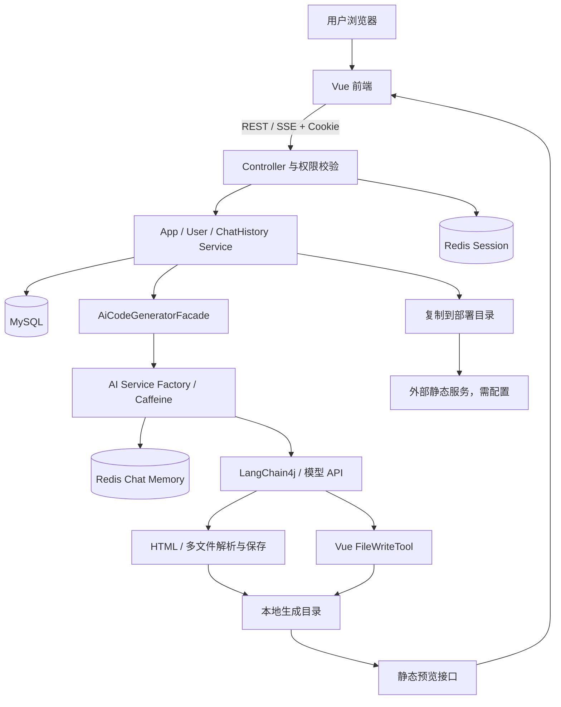

# 方案设计

更新日期：2026-10-14。本设计描述当前实现，并单独说明拟改进方案。

## 1. 技术选型与架构

| 层次 | 当前技术 | 职责 |
| --- | --- | --- |
| 前端 | Vue 3、TypeScript、Vite 7、Ant Design Vue、Pinia、Vue Router | 用户界面、应用/对话管理、Markdown 展示、iframe 预览 |
| HTTP 接口 | Spring Boot 3.5.4、Java 21、Spring MVC、Reactor Flux | REST API、SSE 响应、权限与异常处理 |
| AI 编排 | LangChain4j 1.1.0 / 1.1.0-beta7、OpenAI 兼容接口 | 提示词、模型调用、记忆窗口、工具执行 |
| 持久化 | MySQL、MyBatis-Flex 1.11.1、HikariCP | 用户、应用、业务对话历史 |
| 会话与记忆 | Spring Session Redis、RedisChatMemoryStore | 登录态共享、模型上下文存储 |
| 进程内缓存 | Caffeine | 应用级 AI Service 实例缓存 |
| 文件产物 | 本地文件系统 | 生成源码、复制部署文件 |
| 开发工具 | Maven Wrapper 3.9.11、Knife4j、OpenAPI 前端生成 | 构建与接口协作 |

版本来源：[pom.xml](../pom.xml)、[前端 package.json](../hui-ai-code-mother-frontend/package.json)、[Maven Wrapper 配置](../.mvn/wrapper/maven-wrapper.properties)。



## 2. 代码模块与扩展点

- `controller`：统一接口入口，普通请求返回 `BaseResponse`，生成请求返回 SSE。
- `service/impl`：应用权限和部署、用户身份、历史持久化与恢复。
- `ai`：AI Service 接口、按应用和生成类型创建服务的工厂、提示词与工具。
- `core`：生成门面；`parser` 按模式解析；`saver` 使用模板保存；`handler` 统一处理不同流。
- `config`：跨域、Long JSON 字符串序列化、Redis 记忆和 Vue 模型配置。
- `src/main/java/dev/langchain4j`：与依赖同包同名的定制源码，扩展流式工具调用事件。
- 前端 `src/api`、`stores`、`pages`：生成的 API 类型/客户端、登录状态、业务页面。

新增生成模式需要同步枚举、AI 方法和提示词、工厂分支、生成门面、解析/保存或工具实现、流处理选择及前端展示，不能仅新增枚举值。

## 3. 数据模型与资源生命周期

| 表 | 关键字段 | 关系与索引 |
| --- | --- | --- |
| `user` | `id`、`userAccount`、`userPassword`、`userRole`、用户资料、时间、`isDelete` | 账号唯一；用户名称索引 |
| `app` | `id`、`appName`、`initPrompt`、`codeGenType`、`userId`、`deployKey`、`deployedTime`、`priority` | 用户拥有多个应用；部署标识唯一；用户及名称索引 |
| `chat_history` | `id`、`appId`、`userId`、`message`、`messageType`、时间、`isDelete` | 消息属于应用；应用、时间及 `(appId, createTime)` 索引 |

表结构以 [初始化 SQL](../sql/create_table.sql) 为准。关系由业务代码维护，SQL 未声明外键。用户表使用 `if not exists`，应用和历史表没有该条件；初始化脚本不能当作可重复执行的迁移脚本。

MySQL 对话历史用于界面回放和业务持久化；Redis 保存模型当前记忆窗口；Caffeine 保存本进程服务对象。三者用途不同，Redis TTL 过期不会删除 MySQL 历史。

应用删除会尝试删除历史，但失败只记日志后继续删除应用；尚无事务保证与文件、记忆、缓存清理。后续建议引入明确的资源清理流程及失败重试。

## 4. 生成与上下文链路

1. `AppController.addApp` 固定设置 `vue_project`，没有需求分类或模型自动选择策略。
2. `AppServiceImpl.chatToGenCode` 校验应用和创建者，写入本轮用户消息，读取应用生成类型。
3. 工厂以 `{appId}_{codeGenType}` 为 Caffeine 键，最多缓存 1000 个实例；写入 30 分钟或访问空闲 10 分钟后过期。
4. 每个实例建立以 `appId` 为 ID、最多 20 条消息的 `MessageWindowChatMemory`，存储于 Redis。记忆键只按应用区分，不按生成类型区分。
5. 新建服务时按时间倒序查询 MySQL 历史，使用 `limit(1, 20)` 跳过最新记录，再反转、清空记忆并恢复。这个偏移依赖“先写本轮用户消息”的调用顺序；其他入口及并发请求可能不满足假设。
6. HTML/多文件使用普通聊天模型及流式模型；Vue 使用独立流式模型和 `FileWriteTool`，通过 `@MemoryId` 将应用 ID 传给工具。
7. 门面返回 `Flux<String>`，流处理器负责呈现内容及 AI 历史写入，控制器再封装为 SSE。

实现依据：[AI 工厂](../src/main/java/com/hui/huiaicodemother/ai/AiCodeGeneratorServiceFactory.java)、[历史服务](../src/main/java/com/hui/huiaicodemother/service/impl/ChatHistoryServiceImpl.java)、[生成门面](../src/main/java/com/hui/huiaicodemother/core/AiCodeGeneratorFacade.java)。

Vue 模型 Bean 名为 `reasoningStreamingChatModel`，但当前实际硬编码使用 `deepseek-chat`、8192 tokens；注释中的 `deepseek-reasoner` 是备选方案，未启用。其地址和密钥读取 `langchain4j.open-ai.chat-model` 配置。

## 5. 两类产物保存方式

| 模式 | 生成协议 | 保存时机与目录 |
| --- | --- | --- |
| `html` | 文本流，结束后解析 HTML | `tmp/code_output/html_{appId}/index.html` |
| `multi_file` | 文本流，结束后解析 HTML/CSS/JS | `tmp/code_output/multi_file_{appId}/`，保存 `index.html`、`style.css`、`script.js` |
| `vue_project` | TokenStream，模型调用写文件工具 | 工具执行时写入 `tmp/code_output/vue_project_{appId}/` 下的相对路径 |

HTML/多文件的保存异常被门面捕获并记录日志，可能仍然结束消息流；Vue 工具把 I/O 失败返回为工具文本。当前“流完成”并不等价于“可运行产物构建成功”。

[FileWriteTool](../src/main/java/com/hui/huiaicodemother/ai/tools/FileWriteTool.java) 会接受绝对路径，也没有阻止相对路径穿越。拟改为仅接受相对路径，规范化后检查目标位于应用根目录内，并明确符号链接、文件类型和大小约束。

## 6. 流式消息与前后端协议

Vue 模式内部消息包含三种类型：

| 类型 | 来源 | 流处理器输出 |
| --- | --- | --- |
| `ai_response` | 模型文本片段 | 原样追加文本 |
| `tool_request` | 部分工具调用事件 | 同一工具 ID 首次输出“选择工具：写入文件” |
| `tool_executed` | 工具执行完成 | 文件路径及参数中的内容，以 Markdown 代码块展示并保存历史 |

内部 JSON 经 [JsonMessageStreamHandler](../src/main/java/com/hui/huiaicodemother/core/handler/JsonMessageStreamHandler.java) 转成可读文本后，控制器输出统一外部协议：

```text
data: {"d":"本次文本片段或工具执行说明"}

event: done
data:

```

前端使用 `EventSource`，携带 Cookie，从 `JSON.parse(event.data).d` 累积回复；收到 `done` 关闭连接，再刷新预览。内部工具 JSON 没有直接暴露为前端事件类型。

定制 LangChain4j 源码贯通部分工具请求回调、模型响应处理及 `TokenStream`。升级依赖时需检查同包同名类的签名兼容、回调顺序和工具事件完整性；当前并无独立回归测试覆盖这些改动。

当前前端把部分 `EventSource.CONNECTING` 错误视为完成，组件卸载也未明确关闭局部变量中的连接。拟将生成状态分为运行、成功、失败、取消，并使断连结果可核验。

## 7. 关键接口与权限

以下路径均以 `/api` 为前缀，完整定义以源码和 Knife4j 为准。

| 方法与路径 | 用途 | 权限 |
| --- | --- | --- |
| `POST /user/register`、`POST /user/login` | 注册、登录 | 公开 |
| `GET /user/get/login`、`POST /user/logout` | 登录信息、退出 | 按登录态处理 |
| `POST /app/add` | 创建应用 | 登录用户 |
| `GET /app/get/vo` | 应用详情 | 当前公开 |
| `POST /app/my/list/page/vo` | 我的应用 | 登录用户 |
| `POST /app/good/list/page/vo` | 精选应用 | 公开 |
| `POST /app/update`、`POST /app/deploy` | 改名、部署 | 创建者 |
| `POST /app/delete` | 删除应用 | 创建者或管理员 |
| `GET /app/chat/gen/code?appId=...&message=...` | SSE 生成 | 创建者 |
| `GET /chatHistory/app/{appId}` | 游标查询历史 | 创建者或管理员 |
| `POST /chatHistory/admin/list/page/vo` | 管理员历史查询 | 管理员 |
| `GET /static/{目录标识}/**` | 生成文件预览 | 当前未做应用权限校验 |

Long 统一序列化为字符串，避免浏览器整数精度丢失；前端 OpenAPI 类型需要与此保持一致。

## 8. 预览与部署边界

预览由 [StaticResourceController](../src/main/java/com/hui/huiaicodemother/controller/StaticResourceController.java) 读取生成根目录，目录入口重定向到带斜杠地址，默认返回 `index.html`。当前实现无严格路径规范化和根目录限制。

部署复制 `{codeGenType}_{appId}` 目录至 `tmp/code_deploy/{deployKey}`，更新数据库后返回 `http://localhost/{deployKey}/`。这个地址需要额外静态服务映射部署根目录；后端预览接口读取的是生成目录，不负责托管部署目录。

Vue 工程包含需要 Vite 处理的源码，当前后端不安装依赖、不执行构建，也不切换预览/部署到 `dist`。后续方案应在隔离构建环境执行依赖安装和构建，成功后发布构建产物，以版本目录和原子切换保护已有站点，并验证资源 base 路径和路由回退。

## 9. 本地运行与配置

1. 安装 Java 21、Node.js（建议 22.12+ 或符合 Vite 7 要求的更新版本）、MySQL 和 Redis。
2. 在空数据库环境执行 `sql/create_table.sql`。已有数据库应采用增量迁移，避免直接重复建表。
3. 新建 `src/main/resources/application-local.yml`，覆盖本机数据库、Redis 和模型配置。当前默认启用 `local` profile，且该文件被 Git 忽略。
4. Redis 默认 `localhost:6379`，模型记忆 TTL 为 3600 秒；Session 和 Cookie 配置为 30 天。
5. 模型地址和密钥同时配置 `langchain4j.open-ai.chat-model` 与 `streaming-chat-model`。Vue 模型读取前者的地址/密钥；仅配置后者不足以启用 Vue 生成。
6. 仓库根目录运行 `./mvnw spring-boot:run`；Windows 使用 `.\mvnw.cmd spring-boot:run`。后端端口 8123，接口文档为 `http://localhost:8123/api/doc.html`。
7. 前端目录运行 `npm ci`、`npm run dev`。`VITE_API_BASE_URL` 默认 `http://localhost:8123/api`，`VITE_DEPLOY_DOMAIN` 默认 `http://localhost`；部署服务地址须与后端 `AppConstant.CODE_DEPLOY_HOST` 一致。
8. 生成目录相对于后端启动时的工作目录，部署环境需配置持久化存储和静态服务。

生产配置还需收敛允许携带 Cookie 的跨域来源、采用更适合密码存储的哈希算法、控制模型请求/响应日志。当前代码允许所有来源模式、使用固定盐 MD5，并启用模型日志，不能直接视为生产安全配置。

## 10. 拟改进方案

- 先完成路径隔离与权限、Vue 构建发布和构建阻塞修复，使核心流程可验收。
- 增加生成任务记录及应用级锁，统一失败传播、超时、取消、幂等与文件版本管理。
- 历史游标改为 `(createTime, id)`，恢复记忆使用明确的本轮消息 ID，避免单纯跳过最新记录。
- 清理应用时覆盖 MySQL、Redis、服务缓存及产物，明确失败补偿策略。
- 将模型名称、token 上限和日志策略配置化，集中管理 LangChain4j 定制补丁与兼容验证。
